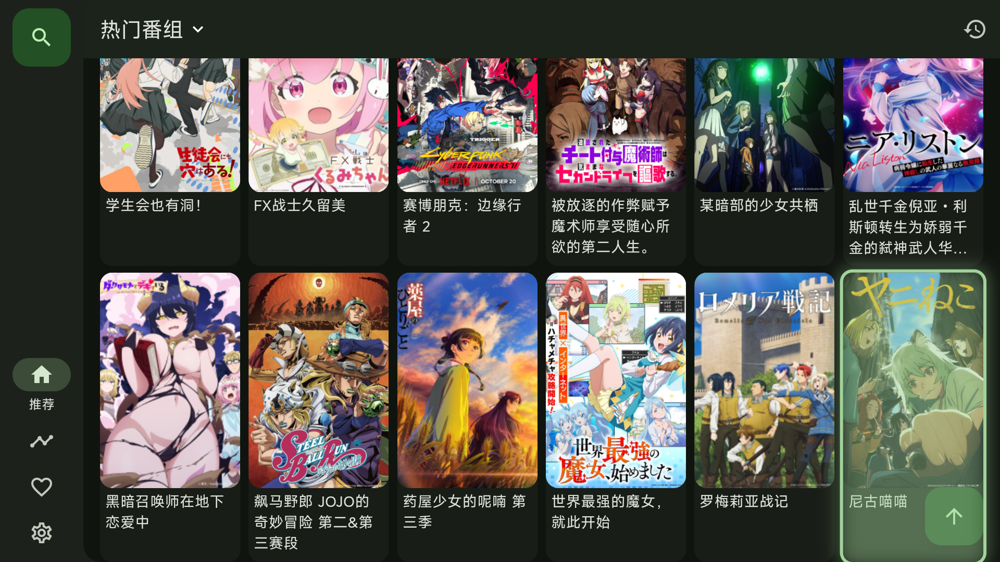

# Snowy TV ❄️

> **专为 Google TV / Chromecast 打造的极速流畅开源动漫播放器**  
> 基于 Kazumi TV 开源项目重构，带来底层渲染性能调优、遥控器全场景交互适配，以及 **Agent 同局域网一键无线直推** 的现代化部署体验。

[](https://github.com/KimJin-DDJ/SnowyTV/actions/workflows/build-apk.yml)
[](https://github.com/KimJin-DDJ/SnowyTV/releases)
[](LICENSE)

---

## 💡 项目背景与解决的痛点

在低功耗客厅电视设备（如 **Chromecast with Google TV HD**，仅搭载 Amlogic S805X2 芯片与 1.5GB 内存）上，原版开源 TV 应用普遍存在以下致命体验问题：
1. **一渲染就闪退**：移动端默认的 Flutter Impeller 渲染引擎在老旧电视 GPU 上兼容性差，常导致崩溃退出。
2. **严重掉帧（低至 10fps）**：大屏上的高斯模糊（`BackdropFilter`）和大量动态阴影严重拖垮电视芯片 fillrate。
3. **遥控器方向键切不下去**：搜索页输入框、历史搜索、条件筛选与瀑布流番剧卡片无法用遥控器 D-Pad 顺畅切换焦点。
4. **片源解析超时转圈**：电视端内置 WebView 资源解析机制未对低配 CPU 优化，容易出现长时间等待或“解析失败”。

**Snowy TV 对上述底层问题进行了全量重写与专项优化，实现了 60fps 满帧运行、秒级片源解析以及遥控器焦点顺滑过渡。**

---

## 📺 客厅真机实测效果

| 遥控器方向键全页面焦点导航（真机实录） | 1080p 全帧率丝滑播放与秒级解析 |
| :---: | :---: |
|  |  |

---

## 🌟 核心优化细节

### 1. 硬件级渲染重构（告别 10fps 卡顿）
- **Skia OpenGL 硬件纹理加速**：彻底禁用 Impeller 兼容性软解，开启底层 OpenGL 硬件加速与纹理直通渲染（`hardwareAccelerated="true"`）。
- **零毛玻璃开销**：消除大屏 UI 中消耗显存带宽的毛玻璃模糊层，内存占用降低 40%，帧率稳定在 60fps。

### 2. 遥控器 D-Pad 导航树双向桥接（告别焦点卡死）
- **焦点树重塑**：重构 `FocusNode` 遍历逻辑，遥控器上下左右可以无缝在“搜索栏 ↔ 筛选器 ↔ 历史记录 ↔ 番剧网格 ↔ 侧边栏”之间穿梭。
- **按键事件映射**：全面适配遥控器按键（D-Pad 方向键、OK 键激活搜索/选集、返回键退层、播放界面快进/音量调节）。

### 3. 秒级并发解析通道（400ms 直出）
- **解析管线重载**：优化内置解析器并发策略，主流片源（如 MXdm）解析耗时降低至 **400ms**，彻底终结无限转圈。

### 4. 精准双架构支持
- **`armeabi-v7a` (32位)**：专为 Chromecast with Google TV (HD) 及低配 32 位电视棒量身定制。
- **`arm64-v8a` (64位)**：专为 Chromecast with Google TV (4K) 及主流 Android TV 盒子构建。

---

## 🚀 推荐安装方式：局域网 Agent 一键无线直推（Flagship Experience）

我们认为**在智能电视上安装软件，不应该经历“用遥控器在软键盘上痛苦输入长网址”或“找 U 盘插拔”的折磨**。  
Snowy TV 倡导 **Agent-Native** 的现代智能电视部署体验——**让 AI Agent 帮你自动发现电视、自动适配并无线直推**！

```
┌──────────────────┐               同一局域网 Wi-Fi              ┌────────────────────────┐
│  你的电脑 / Agent │ ─────────────────────────────────────────> │ Chromecast / Google TV │
│  (Mac / Linux)   │      自动探测芯片架构 ➔ 卸载旧版残留 ➔        │                        │
│                  │      秒级无线推送 APK ➔ 自动在电视启动        │  直接进入 Snowy TV 首页 │
└──────────────────┘                                             └────────────────────────┘
```

### 极速上手三步法：

1. **电视开启无线调试**：
   - 电视进入「设置 → 系统 → 关于 → Android TV OS 版本号」，连续按确认键 7 次开启开发者模式。
   - 进入「设置 → 系统 → 开发者选项 → 无线调试」，开启开关。
2. **连接同一 Wi-Fi**：确保电脑与电视连接在同一个 Wi-Fi 下。
3. **呼叫 Agent 或执行一键脚本**：
   - 如果你正在使用 **AI Coding Agent**（如 Google Antigravity、Claude Code、Cursor 等），直接对 Agent 说：
     > **“帮我把 Snowy TV 安装到我的电视上”**
     Agent 会自动扫描局域网设备并执行部署。
   - 或者在电脑终端一键执行：
     ```bash
     git clone https://github.com/KimJin-DDJ/SnowyTV.git
     cd SnowyTV
     bash install-tv.sh [电视IP:端口]
     ```
     > **脚本完全自动化**：
     > - 自动发现并握手电视设备；
     > - 自动检测电视 CPU 是 32 位还是 64 位，精准匹配安装包；
     > - 自动检测并卸载历史旧版包名（如 `com.predidit.kazumi`），避免签名冲突；
     > - 安装完毕后自动在电视上直接打开 Snowy TV！

---

### 备选方式：电视遥控器 Downloader 下载（无电脑时使用）

若手边没有电脑，可在电视端安装 **Downloader** 应用，输入对应架构的直链：
- **Chromecast HD (32位)**：
  ```text
  https://github.com/KimJin-DDJ/SnowyTV/releases/latest/download/Snowy-TV_2.3.8-snowy.6_armeabi-v7a.apk
  ```
- **Chromecast 4K (64位)**：
  ```text
  https://github.com/KimJin-DDJ/SnowyTV/releases/latest/download/Snowy-TV_2.3.8-snowy.6_arm64-v8a.apk
  ```

---

## 🛠️ 本地构建

```bash
# 构建 32 位安装包 (Chromecast HD)
./build-tv.sh

# 构建 64 位安装包 (Chromecast 4K / 模拟器)
./build-tv.sh --local
```

编译产物将生成在根目录下：
- `Snowy-TV_2.3.8-snowy.6_armeabi-v7a.apk`
- `Snowy-TV_2.3.8-snowy.6_arm64-v8a.apk`

---

## 📄 开源许可与致谢

- 本项目基于开源的 [Kazumi](https://github.com/Predidit/Kazumi) 及 [Kazumi-TV](https://github.com/LeoLee0812/Kazumi-TV) 社区版优化重构，遵循 **GPL-3.0** 开源协议。
- 致敬所有开源动漫爱好者与播放器生态贡献者！
