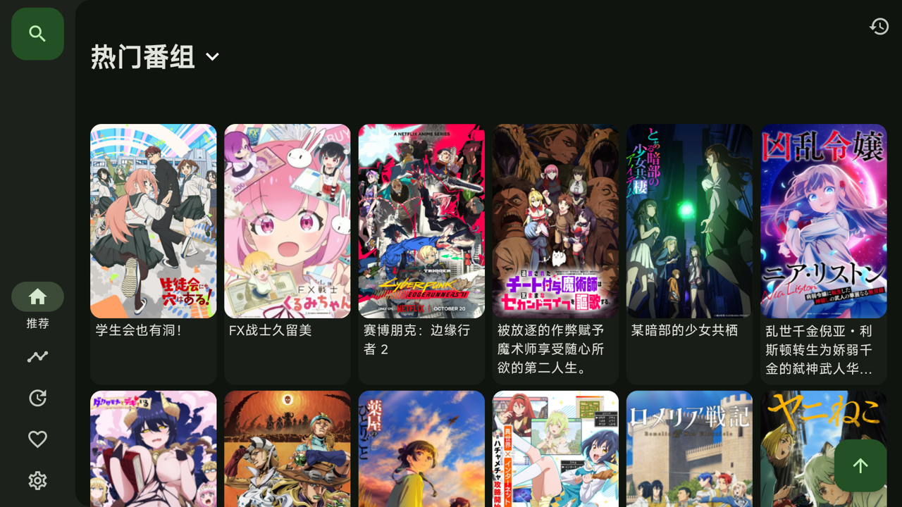
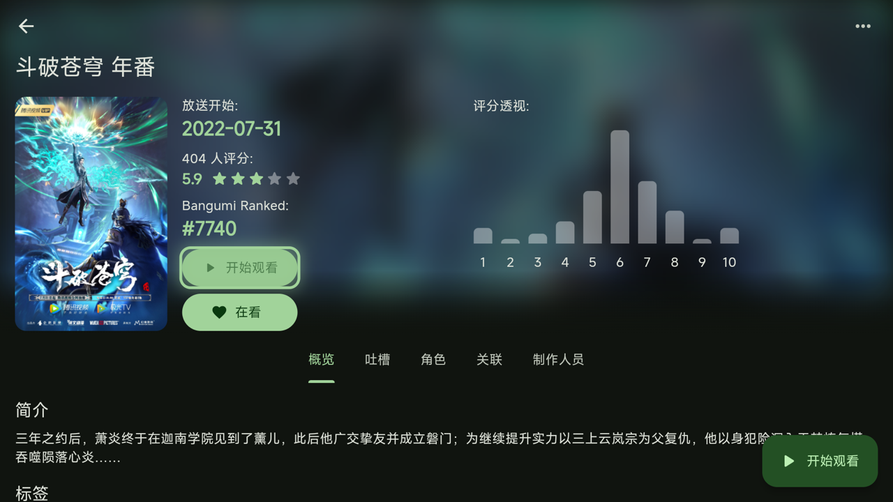
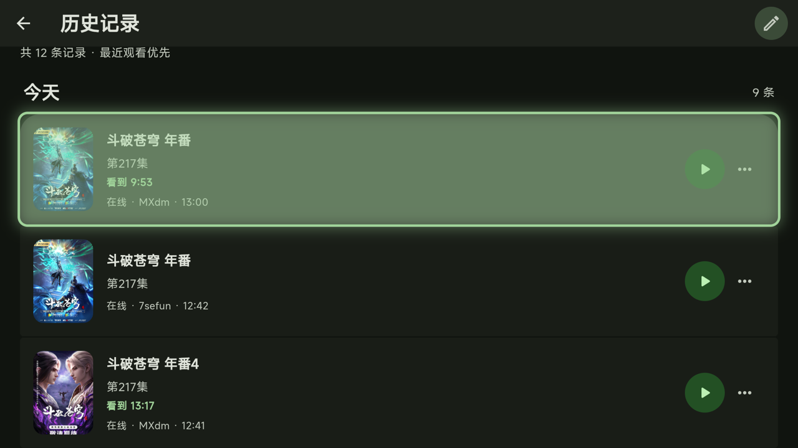
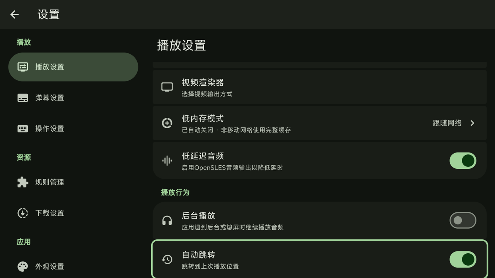

<p align="center">
  
</p>

<h1 align="center">Snowy TV ❄️</h1>

<p align="center">
  <b>专为 Google TV / Chromecast 打造的流畅开源动漫播放器</b><br>
  A fast, open-source anime player built for Google TV and Chromecast with Google TV.
</p>

<p align="center">
  <a href="https://github.com/KimJin-DDJ/SnowyTV/actions/workflows/build-apk.yml"></a>
  <a href="https://github.com/KimJin-DDJ/SnowyTV/releases"></a>
  <a href="LICENSE"></a>
</p>

---

## ⬇️ Download / 下载

**最新版本 Latest release：** <https://github.com/KimJin-DDJ/SnowyTV/releases/latest>

当前版本 `v2.3.8-snowy.8` 提供以下安装包：

| 设备 Device | 架构 ABI | 文件名 File |
| :--- | :--- | :--- |
| Chromecast with Google TV (HD) | `armeabi-v7a` (32-bit) | `SnowyTV-v2.3.8-snowy.8-armeabi-v7a.apk` |
| Chromecast with Google TV (4K) 及多数 Android TV 盒子 | `arm64-v8a` (64-bit) | `SnowyTV-v2.3.8-snowy.8-arm64-v8a.apk` |

不确定设备架构时，Chromecast HD 选择 `armeabi-v7a`。

### 安装方法 / How to install

**方法一：Downloader（无需电脑）**

1. 在电视上安装 **Downloader by AFTVnews**（Google Play 搜索 `Downloader`）。
2. 在手机或电脑上打开上方 Releases 页面，复制对应架构 APK 的下载链接。
3. 打开 Downloader，把链接粘贴到地址栏并按 **Go**，下载完成后点 **安装**。
4. 若提示未知来源被禁止，在弹出的设置里为 Downloader 开启 **允许来自此来源**。若系统隐藏了该选项，请先在 **设置 → 系统 → 关于 → Android TV OS 版本号** 上连续按确认键 7 次开启开发者模式。

**方法二：ADB 命令行（电脑）**

1. 电视开启 **设置 → 系统 → 开发者选项 → 无线调试**，电脑与电视连接同一 Wi-Fi。
2. 安装 Android SDK Platform-Tools，并在终端连接电视：
   ```bash
   adb connect 192.168.1.42:40123   # 换成电视无线调试页面显示的 IP:端口
   adb install -r SnowyTV-v2.3.8-snowy.8-armeabi-v7a.apk
   ```
3. 如果仓库中的脚本更方便，也可以在克隆的仓库目录运行 `bash install-tv.sh 192.168.1.42:40123`。脚本会检查设备架构并安装对应版本。

> 如果安装时提示签名冲突（例如电视上装过其他签名的 Kazumi 版本），请先卸载旧版本，再重新安装。卸载前请备份收藏和观看记录。

---

## 📺 Screenshots / 截图

以下截图均为 Chromecast with Google TV 真机录制。All screenshots were captured on a Chromecast with Google TV.

<table>
  <tr>
    <td align="center"><br><sub>首页：热门番组</sub></td>
    <td align="center"><br><sub>番剧详情与开始观看</sub></td>
  </tr>
  <tr>
    <td align="center"><br><sub>播放界面与控制栏</sub></td>
    <td align="center"><br><sub>观看记录</sub></td>
  </tr>
  <tr>
    <td align="center" colspan="2"><br><sub>播放设置</sub></td>
  </tr>
</table>

---

## ✨ Features / 功能

以下功能均来自源码实现。All features below are implemented in the source code.

- **番剧浏览 Browse**：Bangumi 番剧时间表、热门/推荐列表、最近更新页面。
- **搜索 Search**：适配遥控器的屏幕键盘，支持拼音首字母搜索、搜索历史和筛选条件。
- **片源规则 Sources**：通过规则（插件）导入和管理片源，内置插件商店与规则管理页面。
- **播放 Playback**：多线路切换、选集面板、倍速、画面比例、截图、画质信息，可选硬件解码与渲染器。
- **弹幕 Danmaku**：弹幕源选择、弹幕类型与时间校准，支持屏蔽规则。
- **广告过滤 Ad filter**：针对 M3U8 播放列表的广告过滤。
- **一起看 Watch together**：创建或加入同步观看房间（SyncPlay）。
- **追番与同步 Sync**：Bangumi 账号追番收藏、观看记录，以及 WebDAV 同步。
- **低内存模式 Low-memory mode**：减少资源占用，适合内存较小的电视设备。
- **网络与更新 Network & updates**：代理设置、网络镜像设置、启动时检查更新。
- **外部播放器 External player**：可将视频交给其他播放器打开。

---

## 🎮 遥控器操作 / D-pad Remote

Snowy TV 为电视遥控器设计，全部功能都可以只用方向键和确认键完成。

- **方向键**：在首页、搜索、筛选、番剧网格、侧边栏、选集面板之间移动焦点，焦点框始终可见。
- **确认键 (OK)**：打开番剧、激活搜索、选择线路和集数。
- **返回键 (Back)**：逐层退出页面、面板和播放界面。
- **全屏播放**：左右方向键直接调整进度。

---

## 🚀 Build from source / 从源码构建

环境要求 Requirements：Flutter 3.47.6（见 `pubspec.yaml`）、Android SDK 与 JDK。

```bash
git clone https://github.com/KimJin-DDJ/SnowyTV.git
cd SnowyTV

./build-tv.sh          # armeabi-v7a 安装包（Chromecast HD）
./build-tv.sh --local  # arm64-v8a 安装包（Chromecast 4K / 模拟器）
```

编译产物会生成在仓库根目录：

- `SnowyTV-v2.3.8-snowy.8-armeabi-v7a.apk`
- `SnowyTV-v2.3.8-snowy.8-arm64-v8a.apk`

调试运行可使用 `flutter run`，目标设备选择 Android 模拟器或真机即可。

---

## 📄 License & Credits / 开源许可与致谢

- Snowy TV 基于开源项目 [Kazumi](https://github.com/Predidit/Kazumi) 及 [Kazumi-TV](https://github.com/LeoLee0812/Kazumi-TV) 社区版重构优化，遵循 **GPL-3.0** 开源协议，详见 [LICENSE](LICENSE)。
- 感谢所有开源动漫爱好者与播放器生态的贡献者。
